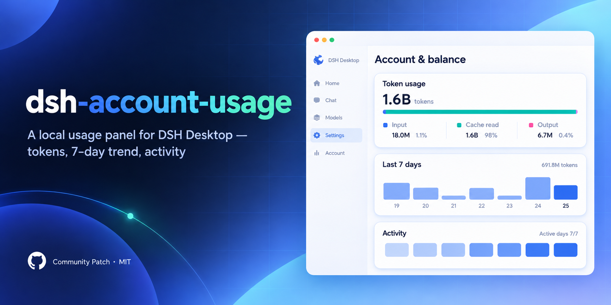
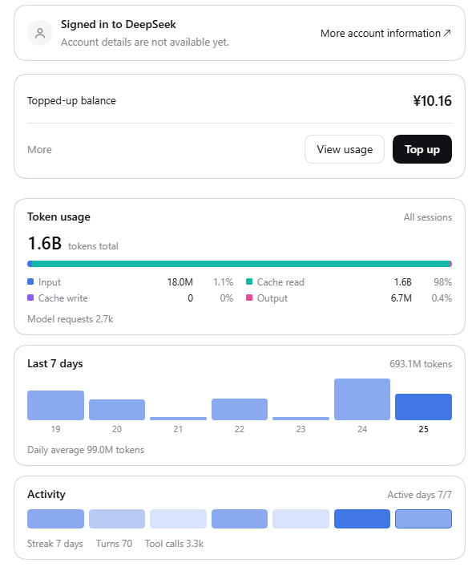

# dsh-account-usage



An unofficial patch for **DSH Desktop** (DeepSeek Harness) that puts a local usage panel under
**Settings → Account & balance**: token usage, last 7 days, and activity.

> [!NOTE]
> This is a community patch, not a DeepSeek product. It edits one file inside your own DSH Desktop
> installation and is reverted automatically when you upgrade the app (then re-apply).

Static preview in light and dark themes: [`docs/preview.html`](docs/preview.html) — download and open it in a browser.

## Screenshots



## What you get

| Card | Contents | Source |
| --- | --- | --- |
| **Token usage** | Lifetime billed tokens, four-bucket composition bar (input / cache read / cache write / output) with shares, model request count | Official `tokenUsage` session projection; falls back to the `contextActivity` day ledger |
| **Last 7 days** | One bar per local calendar day, 7-day total and daily average | `contextActivity.days` (per-day ledger registered by dsh-context) |
| **Activity** | Last 7 days as intensity cells, active days x/7, current streak, turns and tool calls | Same ledger (`requests` / `turns` / `toolCalls`) |

- Scope is **all sessions** listed by the harness (subagent sessions included, counted once).
- Days are **browser-local**; the window re-computes at midnight without reloading.
- Everything is read from the local session store — the panel itself makes no network calls. The only
  request is a same-origin `POST api/dsh-context/backfill` to an *optional* dsh-context route (see below).

## Requirements

| | |
| --- | --- |
| DSH Desktop | Installed Desktop app. Anchor set verified against **0.2.1-rc.2** |
| Node.js | **18 or newer** (the patch scripts only) |
| dsh-context plugin | Optional. Without it: lifetime tokens still work; the per-day window/activity may stay empty |

## Install

The patch edits this file inside your installation:

```
<resources>/app/node_modules/@deepseek-ai/dsh-client-ui-settings-account/lib/client.js
```

Pass the path explicitly, or point at the `resources` directory, or set an env var:

```powershell
# Windows: usually %LOCALAPPDATA%\Programs\DSH Desktop\resources
node src/patch.mjs status --bundle "<install>/resources/app/node_modules/@deepseek-ai/dsh-client-ui-settings-account/lib/client.js"
node src/patch.mjs verify --bundle "<...>/client.js"   # anchors + syntax, writes nothing
node src/patch.mjs apply  --bundle "<...>/client.js"   # backup, then patch
```

```powershell
# or point at the resources directory
node src/patch.mjs apply --resources "<install>/resources"

# or use environment variables
$env:DSH_ACCOUNT_BUNDLE = "<...>/client.js"    # PowerShell
# export DSH_ACCOUNT_BUNDLE="<...>/client.js"  # bash/zsh
```

`apply` is idempotent: an already patched bundle is left alone. Every write is backed up to
`backups/` first, and the candidate text must pass `node --check` before it replaces the file.

Then **fully quit and relaunch DSH Desktop** (the web shell snapshots plugin bundles at host start —
a page refresh does not pick up the change) and open **Settings → Account & balance**.

### Custom install locations

The automatic probe only covers default locations (Windows `%LOCALAPPDATA%\Programs`, `Program Files`;
macOS `/Applications`; Linux `/opt`, `/usr/lib`, `~/.local/share`). If `status` reports that the bundle
could not be located, pass `--bundle` or `--resources` as above.

If you run DSH from source or a global npm install instead of the Desktop app, point `--bundle` at that
installation's `node_modules/@deepseek-ai/dsh-client-ui-settings-account/lib/client.js`.

## Revert and upgrades

```powershell
node src/patch.mjs revert          # restores the most recent backup
```

- Backups live in `backups/` (git-ignored) and are named `client.js.<timestamp>.bak`.
- A DSH Desktop update replaces the installation files, so the patch disappears — run `apply` again.
- If a future release changes the bundle, the anchors stop matching: `apply` aborts with
  `anchor "<name>" matched 0 time(s)` **without touching the file**. Add the new anchor set (or send a
  PR) rather than force-applying.

## How it works

The account settings page is a `settings.section` slot entry with no sub-slot of its own, so the panel
is inserted by editing the shipped client bundle at five anchor points:

1. `en` / `zh` account dictionaries gain the panel copy.
2. A self-contained module (`src/snippet.js`) is inserted before the `AccountSection` region.
3. The original component is renamed `AccountSectionMain`.
4. A new `AccountSection` renders `AccountSectionMain` plus the usage panel in a fragment.
5. The `settings.section` registration injects `refreshSessions` (used to re-read the session list
   after a backfill).

The panel reads the harness's standard `useSessions` hook (root-scope standard kit), is wrapped in its
own error boundary (a broken panel never takes the account cards down with it), and renders nothing
when the hook is absent.

## Development

```powershell
npm run check          # CI gate: syntax + patch-engine test + aggregation test (no install needed)
npm run engine-test    # anchor handling, insertion, idempotence, refusal paths, path detection
npm run logic-test     # window/streak/four-bucket math, hostile-data degradation
npm run load-test      # executes the patched bundle through the shell's __ModuleLoader__ (needs an install)
npm run render-test    # renders the panel with a minimal React shim and asserts the copy/figures
npm run preview        # regenerates docs/preview.html (light + dark, zh); add -- --locale en for English
```

Tests that need a real installation skip with exit code 0 when none is found. Verified versions live in
`src/anchors.mjs` (`VERIFIED_VERSIONS`).

## Compatibility

| DSH release | Status |
| --- | --- |
| `0.2.1-rc.2` | verified (anchors tested end to end) |
| other releases | attempted, aborts safely if anchors moved |

## Legal and privacy

- License: [MIT](LICENSE). Not affiliated with DeepSeek; “DeepSeek Harness”, “DSH” and DSH marks belong
  to their owners.
- The patch edits **your local installation only**. It ships no DSH code, no modified bundles and no
  binaries.
- No telemetry, no remote storage: the panel only reads session projections already held in the
  browser and (optionally) calls the same-origin backfill route of a locally installed plugin.
- Third-party attributions: [THIRD_PARTY_NOTICES.md](THIRD_PARTY_NOTICES.md).

## Acknowledgements

- [dsh-context](https://github.com/bowenliang123/dsh-context) for the per-day activity projection, the
  backfill route and the visual language this panel follows.
- The DSH team for publishing the client packages and their source layouts (MIT).

Contributing: [CONTRIBUTING_en.md](CONTRIBUTING_en.md)

中文文档：[README.md](README.md)
