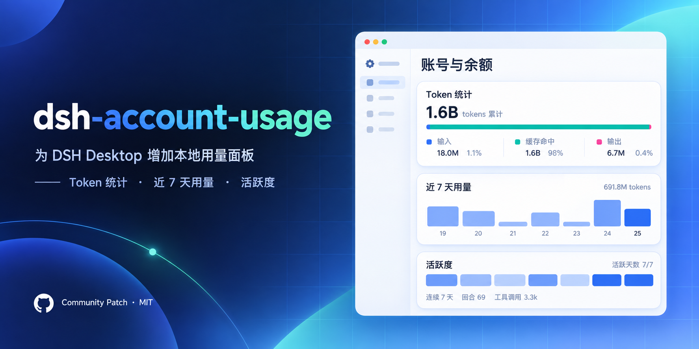
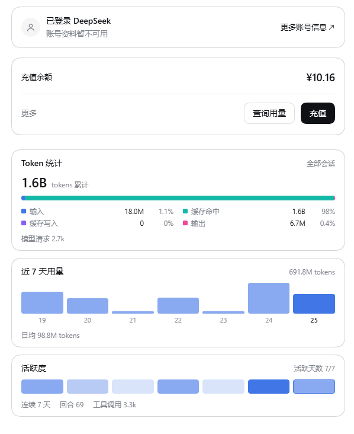

# dsh-account-usage



为 **DSH Desktop**（DeepSeek Harness）准备的社区补丁：在 **设置 → 账号与余额** 下方增加一块本地用量面板，
包含 Token 统计、近 7 天用量与活跃度。

> [!NOTE]
> 这是社区补丁，不是 DeepSeek 官方功能。它只修改你自己机器上 DSH Desktop 安装目录里的一个文件，
> 应用升级后补丁会失效，重跑一次即可。

浅色 / 深色静态预览：[`docs/preview.html`](docs/preview.html)（下载后用浏览器打开）。

## 效果图



## 新增内容

| 卡片 | 内容 | 数据来源 |
| --- | --- | --- |
| **Token 统计** | 累计计费 tokens、四段构成条（输入 / 缓存命中 / 缓存写入 / 输出）及占比、模型请求数 | 官方 `tokenUsage` 会话投影；缺失时退回 `contextActivity` 按天账本 |
| **近 7 天用量** | 每个本地日历日一根柱、7 天合计与日均 | `contextActivity.days`（dsh-context 注册的按天账本） |
| **活跃度** | 近 7 天强度格、活跃天数 x/7、连续天数、回合数、工具调用数 | 同上（`requests` / `turns` / `toolCalls`） |

- 口径为**全部会话**（含子代理会话，且不重复计入父会话）。
- 按**浏览器本地时区**切日；跨零点自动重算，无需刷新。
- 只读本机会话数据，面板自身不发起网络请求；唯一的外部请求是可选的
  `POST api/dsh-context/backfill`（同源、dsh-context 插件的回填路由）。

## 环境要求

| | |
| --- | --- |
| DSH Desktop | 已安装的桌面版；锚点针对 **0.2.1-rc.2** 验证 |
| Node.js | **18 或更高**（仅补丁脚本需要） |
| dsh-context 插件 | 可选。未安装时：累计 Token 仍可用，按天窗口/活跃度可能为空 |

## 安装

补丁修改的是安装目录里的这个文件：

```
<resources>/app/node_modules/@deepseek-ai/dsh-client-ui-settings-account/lib/client.js
```

显式传路径、传 `resources` 目录，或用环境变量：

```powershell
# Windows 通常在 %LOCALAPPDATA%\Programs\DSH Desktop\resources
node src/patch.mjs status --bundle "<install>/resources/app/node_modules/@deepseek-ai/dsh-client-ui-settings-account/lib/client.js"
node src/patch.mjs verify --bundle "<...>/client.js"   # 只校验锚点与语法，不写文件
node src/patch.mjs apply  --bundle "<...>/client.js"   # 备份后打补丁
```

```powershell
# 或指向 resources 目录
node src/patch.mjs apply --resources "<install>/resources"

# 或用环境变量
$env:DSH_ACCOUNT_BUNDLE = "<...>/client.js"    # PowerShell
# export DSH_ACCOUNT_BUNDLE="<...>/client.js"  # bash/zsh
```

`apply` 是幂等的：已打补丁会直接跳过。每次写入前都会备份到 `backups/`，并在替换文件前用
`node --check` 做语法门禁。

然后**完全退出并重新启动 DSH Desktop**（Web 外壳在 host 启动时对插件 bundle 做快照，刷新页面不会重新读取），
打开 **设置 → 账号与余额**。

### 自定义安装位置

自动探测只覆盖默认位置（Windows 的 `%LOCALAPPDATA%\Programs`、`Program Files`；macOS 的
`/Applications`；Linux 的 `/opt`、`/usr/lib`、`~/.local/share`）。如果 `status` 提示找不到 bundle，
按上面的方式传 `--bundle` 或 `--resources`。

如果你用的是源码启动或全局 npm 安装的 DSH，把 `--bundle` 指向那份安装里的
`node_modules/@deepseek-ai/dsh-client-ui-settings-account/lib/client.js`。

## 回滚与升级

```powershell
node src/patch.mjs revert          # 还原最近一次备份
```

- 备份在 `backups/`（已被 .gitignore 忽略），命名 `client.js.<时间戳>.bak`。
- DSH Desktop 升级会替换安装文件，补丁随之消失——重跑一次 `apply` 即可。
- 若新版本的 bundle 结构变了，锚点将无法匹配：`apply` 会以
  `anchor "<name>" matched 0 time(s)` 中止，且**不修改文件**。此时应补充锚点表（或提 PR），不要强行套用。

## 实现方式

账号设置页是一个 `settings.section` slot 条目，自身没有子 slot，所以面板通过五处锚点修改已编译的
client bundle 插入：

1. `en` / `zh` 账号字典追加面板文案；
2. 在 `AccountSection` 区域前插入自包含模块（`src/snippet.js`）；
3. 原组件更名为 `AccountSectionMain`；
4. 新增 `AccountSection`，用 `Fragment` 同时渲染原组件与用量面板；
5. `settings.section` 注册项的注入里追加 `refreshSessions`（回填后重新读取会话列表）。

面板读取框架的 `useSessions` 标准钩子（root scope 标准 kit），自带错误边界（面板出错不会连累账号与余额卡片），
钩子缺失时整块不渲染。

## 开发与测试

```powershell
npm run check          # CI 门禁：语法 + 补丁引擎测试 + 聚合逻辑测试（无需安装）
npm run engine-test    # 锚点处理、插入、幂等、拒绝路径、安装路径探测
npm run logic-test     # 窗口 / 连续天数 / 四桶 / 敌意数据降级
npm run load-test      # 按 __ModuleLoader__ 协议执行补丁后 bundle（需要安装）
npm run render-test    # 用 React 垫片渲染面板并断言文案与数字
npm run preview        # 重新生成 docs/preview.html（浅色 + 深色，中文）；加 -- --locale en 生成英文版
```

需要真实安装的测试在找不到安装时会以退出码 0 跳过。已验证版本登记在 `src/anchors.mjs` 的
`VERIFIED_VERSIONS` 中。

## 兼容性

| DSH 版本 | 状态 |
| --- | --- |
| `0.2.1-rc.2` | 已验证（锚点端到端测试） |
| 其它版本 | 会尝试套用；锚点移动则安全中止 |

## 许可与隐私

- 许可：[MIT](LICENSE)。与 DeepSeek 无关联；“DeepSeek Harness”“DSH”等标识归其所有者。
- 补丁只修改**你本机的安装**，不附带任何 DSH 代码、修改后的 bundle 或二进制。
- 无遥测、无远程存储：面板只读浏览器里已有的会话投影，另可选调用本地插件同源的回填路由。
- 第三方声明：[THIRD_PARTY_NOTICES.md](THIRD_PARTY_NOTICES.md)。

## 致谢

- [dsh-context](https://github.com/bowenliang123/dsh-context)：提供了本面板使用的按天活动投影、回填路由与视觉语言。
- DSH 团队：公开了客户端包与源码布局（MIT）。

参与贡献：[CONTRIBUTING.md](CONTRIBUTING.md)

English documentation: [README.en.md](README.en.md)
